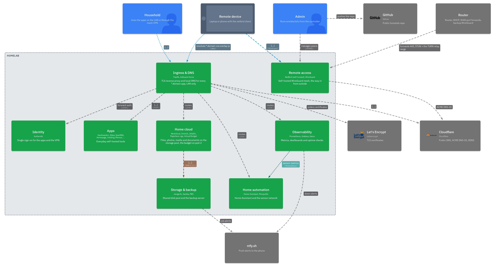

# homelab

A 3-node Proxmox homelab, running since 2025. Hosts, guests and apps are code: OpenTofu, Ansible and NixOS, checked in CI. Every design decision is a written record ([docs/adr](docs/adr/README.md)).

Domain, MACs and keys are placeholders; the real values live in a gitignored `private.yml`.

## What this shows

- One set of facts drives OpenTofu, Ansible and NixOS, an IP or a port is set in one place ([ADR 0007](docs/adr/0007-group-vars-single-source-of-truth.md))
- One entry in `apps.yml` per app: its firewall rules, routes, DNS, uptime checks and dashboard tile follow from it ([apps](docs/apps.md))
- Rootless Podman, one user per app, health checks that restart a broken container and roll back a bad update ([ADR 0021](docs/adr/0021-podman-quadlets.md))
- No port forward to an app: from outside only through the VPN, and who reaches what is policy as code ([ADR 0040](docs/adr/0040-netbird-policy-as-code.md))
- A written threat model with its accepted risks ([security](docs/security.md))
- The same checks locally and in CI ([checks](docs/checks.md)), every decision recorded ([ADRs](docs/adr/README.md))



- Interactive diagrams: [yaml-0x74696d.github.io/homelab](https://yaml-0x74696d.github.io/homelab/), clickable (built by `.github/workflows/pages.yml`)
- More pictures: [docs/architecture.md](docs/architecture.md) (zones, flows, per-node views); sensors and the IoT gateway: [docs/iot.md](docs/iot.md)

## Hardware

| Node | Box | RAM | Role |
|---|---|---|---|
| pve-1 | Small form factor PC | 8 GB | Running the edge VM, its WiFi card is the IoT AP (in CT 302) |
| pve-2 | Small form factor PC | 8 GB | Running the NetBird VM and routing peer |
| pve-3 | Desktop PC, 1 SSD + 4 HDDs | 16 GB | ~11 TB HDD in a mergerfs pool, running PBS |
| ctl-1 | Single-board computer (arm64), SD card | little | Not in the cluster: Semaphore, always on, .100 |

## VM/LXC

| Guest | ID | Node | CPU | RAM (balloon floor) | Disk | IP |
|---|---|---|---|---|---|---|
| pod-1 | VM 201 | pve-1 | 4 | 4 GB (3 GB) | 32 GB | .201 |
| pod-2 | VM 202 | pve-2 | 4 | 4 GB (2 GB) | 32 GB | .202 |
| pod-3 | VM 203 | pve-3 | 4 | 12 GB (8 GB) | 64 GB | .203 |
| netbird | VM 250 | pve-2 | 2 | 2 GB (1 GB) | 20 GB | .250 |
| edge | VM 200 | pve-1 | 1 | 1.5 GB (1.5 GB) | 16 GB | .200 (+ DNS service IP .53) |
| haos | VM 210 | pve-3 | 2 | 3 GB (no balloon) | 32 GB | .210 |
| storage | CT 300 | pve-3 | 2 | 1 GB + 512 MB swap | 24 GB | .150 |
| log | CT 301 | pve-3 | 1 | 512 MB + 256 MB swap | 32 GB | .151 |
| iot | CT 302 | pve-1 | 1 | 512 MB + 256 MB swap | 8 GB | .152 + IoT `.50.10` on its WiFi card |

- Specs can be found in `tofu/locals.tf`; IDs + IPs are in `ansible/group_vars/all/network.yml`

## What runs

| Group | App | Host | Purpose |
|---|---|---|---|
| Ingress & DNS | Traefik + AdGuard Home | edge (NixOS) | Reverse proxy (TLS via Cloudflare DNS-01) and LAN DNS + ad blocking, routers and rewrites built from `apps.yml` |
| Ingress & DNS | dns-relay (CoreDNS) | pod-2 | DNS for VPN clients, forwards to the LAN DNS |
| Ingress & DNS | cloudflare-ddns | pod-1, pod-2 | Keeps the public records current, one copy per host |
| Identity | Authentik | pod-1 | SSO, OIDC + forward-auth |
| Home cloud | Immich | pod-3 | Photos |
| Home cloud | Jellyfin | pod-3 | Video |
| Home cloud | Nextcloud | pod-3 | Files |
| Home cloud | Paperless | pod-3 | Documents |
| Home cloud | Actual Budget | pod-2 | Budget, login through Authentik only |
| Home automation | Home Assistant | haos (VM on pve-3) | Home automation, HAOS appliance |
| Home automation | Mosquitto | iot (CT 302) | MQTT broker, from Debian |
| Home automation | mqtt-exporter | iot (CT 302) | MQTT → Prometheus, from Debian |
| Home automation | nginx | iot (CT 302) | Firmware downloads for the sensors, from Debian |
| Home automation | hostapd + dnsmasq | iot (CT 302) | IoT WiFi + DHCP on pve-1's card, inside the CT |
| Observability | Prometheus | pod-2 | Metrics |
| Observability | Grafana | pod-2 | Dashboards |
| Observability | Gatus | pod-2 | Uptime checks, generated from the apps map |
| Apps | Vaultwarden | pod-1 | Passwords |
| Apps | Homepage | pod-1 | Landing page |
| Apps | Gitea | pod-1 | git server |
| Apps | SearXNG | pod-1 | Search engine |
| Apps | pdfcraft | pod-1 | PDF tools |
| Apps | linkding | pod-3 | Bookmarks, login through Authentik only |
| Apps | Memos | pod-3 | Notes |
| Apps | Excalidraw | pod-3 | Whiteboard, behind Authentik, a CSP keeps it off excalidraw.com |
| Apps | nginx | pod-2 | Website |
| Operations | Semaphore | ctl-1 | Playbook runs on a schedule + run history, from a git clone of `semaphore_repo_version` |

## Stack

- Proxmox (3 nodes) · OpenTofu (bpg/proxmox + netbirdio/netbird) · Ansible · Podman (rootless quadlets) · NixOS (NetBird VM, edge) · PBS · NetBird · Traefik · AdGuard Home · Authentik

## Security

- Only the NetBird VM is forwarded from the WAN, apps are LAN and VPN only
- Authentik logins for the apps, rootless Podman, default-deny firewalls, AIDE, PBS backups, secrets in Ansible Vault
- Threat model, trust zones, every control with the code or ADR that enforces it, and the accepted risks: [docs/security.md](docs/security.md)

## Decisions

- [docs/adr/](docs/adr/README.md): one record per decision
- 0001 OpenTofu + cloud-init · 0002 generic app role (superseded by [0021](docs/adr/0021-podman-quadlets.md)) · 0003 NetBird · 0004 mergerfs · 0005 prevent_destroy
- 0006 `:latest` + Diun (superseded by [0021](docs/adr/0021-podman-quadlets.md)) · 0007 group_vars as source of truth · 0008 NixOS DMZ (superseded by [0035](docs/adr/0035-nixos-for-netbird-and-edge.md)) · 0009 AIDE · 0010 LAN DNS service IP
- 0011 Proxmox as hypervisor · 0012 no Kubernetes (superseded by [0033](docs/adr/0033-no-kubernetes.md)) · 0013 PBS file-level backups · 0014 Authentik · 0015 TLS via DNS-01 (superseded by [0034](docs/adr/0034-tls-via-dns-01.md))
- 0016 Ansible Vault · 0017 SMB to the pod VMs · 0018 DOCKER-USER filtering (superseded by [0026](docs/adr/0026-ufw-as-guest-firewall.md)) · 0019 ntfy alerts · 0020 same checks locally + CI · 0021 Podman quadlets
- 0022 central logging over RELP · 0023 chrony with NTS · 0024 OS updates through Ansible · 0025 Debian guests until x86-64-v3 · 0026 ufw as the guest firewall · 0027 Gatus from the apps map
- 0028 IoT gateway LXC · 0029 WiFi card in the gateway · 0030 HAOS VM on pve-3 · 0031 Semaphore on a single-board computer · 0032 edge VM · 0033 no Kubernetes · 0034 TLS via DNS-01 · 0035 NixOS for NetBird + edge · 0036 AI assistant in a sandbox · 0037 Actual Budget · 0038 linkding, Memos, Excalidraw · 0039 Syncthing ctl-0 ↔ ctl-1 · 0040 NetBird policy as code · 0041 Grafana dashboards as code

## Docs

- Where things go and which value wins: [Ansible](docs/ansible-layout.md), [OpenTofu](docs/tofu-layout.md), [Podman](docs/podman-layout.md), [NixOS](docs/nixos-layout.md)
- Running it: [updates](docs/updates.md), [adding and removing apps](docs/apps.md), [troubleshooting](docs/troubleshooting.md), [new hardware](docs/new-hardware.md), [security](docs/security.md), [netbird](docs/netbird.md), [checks](docs/checks.md), from bare hardware: [bootstrap](docs/bootstrap.md)

## Deployment

- Copy `vault.yml.example` → `vault.yml`, create `ansible/.vault_pass`
- Copy `private/private.yml.example` → `private/private.yml` and fill in your domain, macs, disk uuids, keys (gitignored, nothing secret)
- `just setup` · `just check` · `just deploy-app <app>` · `just c4`
- Needs: just, pre-commit, Ansible, OpenTofu, Nix, Node, d2 (only for `just diagrams`) (the hooks install ansible-lint, yamllint, shellcheck, actionlint, zizmor, gitleaks)
- From bare hardware, in order: [docs/bootstrap.md](docs/bootstrap.md)
- OpenTofu: tfvars from the example, `tofu apply`
- Ansible: `vm-preparation.yml`, then `site.yml` or one `deploy-<app>.yml`
- ctl-1: admin user by hand (`roles/ctl_base/README.md`), then `ctl-preparation.yml`, `base.yml`, `deploy-app.yml -e app=semaphore`
- Plain `ansible-playbook` is the main path; for an EE run copy `ansible-navigator.yml.example` → `ansible-navigator.yml` and mount the private folder
- NixOS: nixos-anywhere once per VM, then `nixos/update.sh <netbird|edge>`. `nix flake check` needs builds (facts.nix), `--no-build` fails

## File layout

```
tofu/            VMs + LXCs on Proxmox (bpg/proxmox, Debian cloud image, cloud-init)
ansible/
  group_vars/all/  Variables: network, ports, storage, hosts, apps, base (+ vault.yml.example, private/private.yml.example)
  group_vars/<group>.yml  login per group (user, become)
  inventory.yml    hosts only: pod_vms, podman_hosts (ctl-1), proxmox, lxc_containers, netbird_agent, appliances (haos)
  roles/           aide, chrony, cronie, ctl_base, gatus_push, iot_ap, iot_node, journald, login_notify, lxc_base, mergerfs, mosquitto, mqtt_exporter, netbird_agent, ota_server, pbs, podman_app, podman_base, pve_firewall, pve_thinpool, reach, rsyslog, samba, update, vm_base
  apps/<name>/     Quadlet units + templates per app
  playbooks/       deploy-<app>.yml, deploy-app.yml (podman), site.yml, vm-preparation, update, aide, push-keys, ...
nixos/           Flake for the NixOS VMs: netbird, edge (+ update.sh, aide-accept.sh)
architecture/    LikeC4 model: landscape, containers, deployment, flows
docs/            Architecture, ADRs, exported diagrams
rendered_config/ Podman apps rendered with example values for review (just render, CI keeps it current)
justfile         setup · lint · check · deploy · deploy-app · render · quadlet · c4 · diagrams
```

## Single source of truth

- Ansible group_vars get read by OpenTofu (yamldecode) and Nix (facts.nix), so an IP only has to change in one place ([ADR 0007](docs/adr/0007-group-vars-single-source-of-truth.md))
- `tofu/locals.tf` reads `network.yml`, `ports.yml`, `hosts.yml`, `storage.yml`, `apps.yml`, `private/private.yml` with `yamldecode`
- `nixos/facts.nix` turns `network`, `ports`, `hosts`, `app_settings`, `apps`, `base`, `schedules`, `private/private.yml` and `inventory.yml` into JSON with yq-go
- `nixos/update.sh` + `aide-accept.sh` read the host IP (`netbird_ip`, `edge_ip`) from the same file
- edge reads `apps.yml` too: every route becomes a Traefik router and an AdGuard rewrite ([nixos-layout](docs/nixos-layout.md#how-edge-builds-its-routes))
- Ports: `port` in `apps.yml` → Podman units, Traefik routes, Gatus and Homepage checks, firewall
- Secrets: one `vault.yml` (Ansible Vault) → Podman secrets (`secrets:` in `apps.yml`)
- No magic numbers: every timeout, schedule, size and port is a named variable (role defaults, playbook `vars:`, Nix `let`)

## Future plans

- The restore rehearsal again, on Podman only ([docs/restore-rehearsal.md](docs/restore-rehearsal.md) still walks through a compose app)
- A remove path in `podman_app` (`state: absent`), today a removal is a checklist ([docs/apps.md](docs/apps.md#remove-an-app))
- Later: guest OS Debian → EL10 once the hardware has x86-64-v3 / AVX2 ([ADR 0025](docs/adr/0025-debian-guests-until-x86-64-v3.md)); Proxmox hosts stay Debian

## License

MIT, see [LICENSE](LICENSE).
