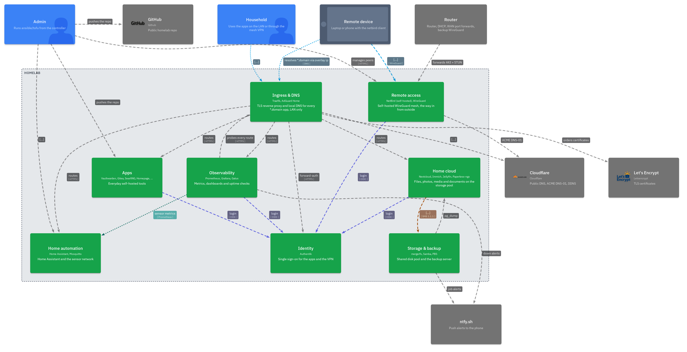

# homelab

- Overview of my 3-node Proxmox homelab. With this project I am going for full IaC, through Ansible, OpenTofu and NixOS.
- This repo is a showcase copy of my private repo (self-hosted Gitea), renamed and with placeholders.



- Interactive diagrams: [yaml-0x74696d.github.io/homelab](https://yaml-0x74696d.github.io/homelab/), all 23 views, clickable (built by `.github/workflows/pages.yml`)
- More pictures: [docs/architecture.md](docs/architecture.md) (zones, flows, per-node views); sensors and the IoT gateway: [docs/iot.md](docs/iot.md); where things go and which value wins: [Ansible](docs/ansible-layout.md), [OpenTofu](docs/tofu-layout.md), [Podman](docs/podman-layout.md), [NixOS](docs/nixos-layout.md)
- Running it: [updates](docs/updates.md), [adding and removing apps](docs/apps.md), [troubleshooting](docs/troubleshooting.md), [new hardware](docs/new-hardware.md), from bare hardware: [bootstrap](docs/bootstrap.md)

## Overview

- 3 Proxmox nodes, 4 VMs + 3 LXCs, 17 Podman apps, 23 Ansible roles, 21 playbooks, 23 C4 views
- 3 tools, 1 set of facts: provisioning through OpenTofu, configuration through Ansible, the WAN-facing VM declared in NixOS
- Remote access through NetBird: the router forwards only to the NixOS VM, never directly to an app
- Every check runs the same locally and in CI: 26 pre-commit hooks (`just check`, the `apps.yml` schema included) and the Podman units through `quadlet -dryrun` (`just quadlet`)

## Hardware

| Node | Box | RAM | Role |
|---|---|---|---|
| pve-1 | Small form factor PC | 8 GB | Running the IoT WiFi AP directly and the edge VM |
| pve-2 | Small form factor PC | 8 GB | Running the NetBird VM and routing peer |
| pve-3 | Desktop PC, 1 SSD + 4 HDDs | 16 GB | ~11 TB HDD in a mergerfs pool, running PBS |
| ctl-1 | Raspberry Pi 3 (Raspberry Pi OS Lite), 16 GB SD | 1 GB | Not in the cluster: Semaphore, always on, .100 |

## VM/LXC

| Guest | ID | Node | CPU | RAM (balloon floor) | Disk | IP |
|---|---|---|---|---|---|---|
| pod-1 | VM 201 | pve-1 | 4 | 4 GB (3 GB) | 32 GB | .201 |
| pod-2 | VM 202 | pve-2 | 4 | 4 GB (2 GB) | 32 GB | .202 |
| pod-3 | VM 203 | pve-3 | 4 | 12 GB (8 GB) | 64 GB | .203 |
| netbird | VM 250 | pve-2 | 2 | 2 GB (1 GB) | 20 GB | .250 |
| edge | VM 200 | pve-1 | 1 | 1.5 GB (1.5 GB) | 16 GB | .200 (+ DNS service IP .53) |
| storage | CT 300 | pve-3 | 2 | 1 GB + 512 MB swap | 24 GB | .150 |
| log | CT 301 | pve-3 | 1 | 512 MB + 256 MB swap | 32 GB | .151 |
| iot | CT 302 | pve-1 | 1 | 512 MB + 256 MB swap | 8 GB | .152 + IoT `.50.10` on its WiFi card |

- Specs can be found in `tofu/locals.tf`; IDs + IPs are in `ansible/group_vars/all/network.yml`

## Stack

- Proxmox (3 nodes) · OpenTofu (bpg/proxmox) · Ansible · Podman (rootless quadlets) · NixOS (NetBird VM, edge) · PBS · NetBird · Traefik · AdGuard Home · Authentik

## What runs

| Group | App | Host | Purpose |
|---|---|---|---|
| Ingress | Traefik + AdGuard Home | edge (NixOS) | Reverse proxy (TLS via Cloudflare DNS-01) and LAN DNS + ad blocking, routers and rewrites built from `apps.yml` |
| Ingress | dns-relay (CoreDNS) | pod-2 | DNS for VPN clients, forwards to the LAN DNS |
| Ingress | cloudflare-ddns | pod-1, pod-2 | Keeps the public records current, one copy per host |
| Identity | Authentik | pod-1 | SSO, OIDC + forward-auth |
| Identity | Vaultwarden | pod-1 | Passwords |
| Media | Immich | pod-3 | Photos |
| Media | Jellyfin | pod-3 | Video |
| Media | Nextcloud | pod-3 | Files |
| Media | Paperless | pod-3 | Documents |
| Home | Home Assistant | haos (VM on pve-3) | Home automation, HAOS appliance |
| Home | Mosquitto | iot (CT 302) | MQTT broker, from Debian |
| Home | mqtt-exporter | iot (CT 302) | MQTT → Prometheus, from Debian |
| Home | nginx | iot (CT 302) | Firmware downloads for the sensors, from Debian |
| Home | hostapd + dnsmasq | iot (CT 302) | IoT WiFi + DHCP on pve-1's card, moved into the CT |
| Monitoring | Prometheus | pod-2 | Metrics |
| Monitoring | Grafana | pod-2 | Dashboards |
| Monitoring | Gatus | pod-2 | Uptime checks, generated from the apps map |
| Tools | Homepage | pod-1 | Landing page |
| Tools | Gitea | pod-1 | git server |
| Tools | SearXNG | pod-1 | Search engine |
| Tools | pdfcraft | pod-1 | PDF tools |
| Tools | nginx | pod-2 | Website |
| Tools | Semaphore | ctl-1 | Playbook runs on a schedule + run history, from a git clone of `semaphore_repo_version` |

## File layout

```
tofu/            VMs + LXCs on Proxmox (bpg/proxmox, Debian cloud image, cloud-init)
ansible/
  group_vars/all/  Variables: network, ports, storage, hosts, apps, base (+ vault.yml.example, private/private.yml.example)
  group_vars/<group>.yml  login per group (user, become)
  inventory.yml    hosts only: pod_vms, podman_hosts (ctl-1), proxmox, lxc_containers, netbird_agent, appliances (haos)
  roles/           aide, chrony, cronie, ctl_base, iot_ap, iot_node, journald, login_notify, lxc_base, mergerfs, mosquitto, mqtt_exporter, netbird_agent, ota_server, pbs, podman_app, podman_base, pve_firewall, reach, rsyslog, samba, update, vm_base
  apps/<name>/     Quadlet units + templates per app (17)
  playbooks/       deploy-<app>.yml, deploy-app.yml (podman), site.yml, vm-preparation, update, aide, push-keys, ...
nixos/           Flake for the NixOS VMs: netbird, edge (+ update.sh, aide-accept.sh)
architecture/    LikeC4 model: landscape, containers, deployment, 8 flows
docs/            Architecture, ADRs, exported diagrams
rendered_config/ Podman apps rendered with example values for review (just render, CI keeps it current)
justfile         setup · lint · check · deploy · deploy-app · render · c4 · diagrams
```

## Single source of truth

- Ansible group_vars get read by OpenTofu (yamldecode) and Nix (facts.nix), so an IP only has to change in one place ([ADR 0007](docs/adr/0007-group-vars-single-source-of-truth.md))
- `tofu/locals.tf` reads `network.yml`, `ports.yml`, `hosts.yml`, `storage.yml`, `private/private.yml` with `yamldecode`
- `nixos/facts.nix` turns `network`, `ports`, `hosts`, `apps`, `base`, `private/private.yml` YAML into JSON with yq-go
- `nixos/update.sh` + `aide-accept.sh` read the host IP (`netbird_ip`, `edge_ip`) from the same file
- edge reads `apps.yml` too: every route becomes a Traefik router and an AdGuard rewrite ([nixos-layout](docs/nixos-layout.md#how-edge-builds-its-routes))
- Ports: `port` in `apps.yml` → Podman units, Traefik routes, Gatus and Homepage checks, firewall
- Secrets: one `vault.yml` (Ansible Vault) → Podman secrets (`secrets:` in `apps.yml`)
- No magic numbers: every timeout, schedule, size and port is a named variable (role defaults, playbook `vars:`, Nix `let`)

## Deployment

- Copy `vault.yml.example` → `vault.yml`, create `ansible/.vault_pass`
- Copy `private/private.yml.example` → `private/private.yml` and fill in your domain, macs, disk uuids, keys (gitignored, nothing secret)
- `just setup` · `just check` · `just deploy <app>` · `just c4`
- Needs: just, pre-commit, Ansible, OpenTofu, Nix, Node, d2 (only for `just diagrams`) (the hooks install ansible-lint, yamllint, shellcheck, actionlint, zizmor, gitleaks)
- From bare hardware, in order: [docs/bootstrap.md](docs/bootstrap.md)
- OpenTofu: tfvars from the example, `tofu apply`
- Ansible: `vm-preparation.yml`, then `site.yml` or one `deploy-<app>.yml`
- ctl-1 (the Pi): admin user by hand (`roles/ctl_base/README.md`), then `ctl-preparation.yml`, `base.yml`, `deploy-app.yml -e app=semaphore`
- Plain `ansible-playbook` is the main path; for an EE run copy `ansible-navigator.yml.example` → `ansible-navigator.yml` and mount the private folder
- NixOS: nixos-anywhere once per VM, then `nixos/update.sh <netbird|edge>`. `nix flake check` needs builds (facts.nix), `--no-build` fails

## Security

- WAN: only the NetBird VM is forwarded (443/tcp, 3478/udp, narrow TURN relay range); apps are LAN / VPN only
- PVE firewall (`roles/pve_firewall`): cluster policy drop, NetBird VM fenced (inbound = what NetBird serves, egress to the LAN limited to routing peer + DNS/HTTPS + RELP to the log LXC); host lockdown layer written, off by default (lockout risk)
- Pod VMs (`vm-preparation.yml` = `roles/vm_base` + ufw + Podman): ufw default deny, SSH key-only + rate-limited, no root login, auditd, AppArmor, fail2ban, sysctl hardening, unattended security updates
- LXCs (`roles/lxc_base`): SSH key-only (root by key, no passwords), fail2ban, unattended security updates, node_exporter
- IoT gateway LXC: PVE guest firewall and ufw with the same inbound rules, from the IoT net only 1883 and 80 (firmware downloads), egress limited to DNS, RELP and HTTP/HTTPS; one shared MQTT user, no TLS (accepted risk, [ADR 0028](docs/adr/0028-iot-gateway-lxc.md))
- HAOS VM: PVE guest firewall, HA only from Traefik and Homepage, admins direct ([ADR 0030](docs/adr/0030-haos-vm-on-pve-3.md))
- App ports: one ufw rule per port and source from `allow_from` in `apps.yml` (backends only answer edge, pod-2 and Homepage)
- Podman apps: rootless, one svc user per app, no container socket anywhere
- NixOS VMs (netbird, edge): nftables default-deny, SSH LAN-only, AppArmor, fail2ban, kernel sysctls, auto-upgrade with reboot window
- NetBird dashboard + API LAN/VPN only: the WAN sees just the gRPC endpoints peers need; probes get a silent close (444) and a fail2ban ban
- Identity: Authentik OIDC for the apps (local admin kept as break-glass, except Vaultwarden), forward-auth for apps without SSO
- TLS everywhere via Let's Encrypt DNS-01 (Cloudflare), no port 80 forwarded from the WAN
- AIDE on every host + the NixOS VMs: daily check, ntfy alert with counts only, accept by hand, DB hash kept on the controller
- login-notify: ntfy push on every SSH / Proxmox web login (PVE hosts)
- Backups: PBS, scoped token that can only write, DB dumps before each run; a restore is rehearsed before each rebuild ([docs/restore-rehearsal.md](docs/restore-rehearsal.md))
- Secrets: Ansible Vault; gitleaks on every commit and over the full history in CI

## Decisions

- [docs/adr/](docs/adr/README.md): 32 records
- 0001 OpenTofu + cloud-init · 0002 generic app role · 0003 NetBird · 0004 mergerfs · 0005 prevent_destroy
- 0006 `:latest` + Diun · 0007 group_vars as source of truth · 0008 NixOS DMZ · 0009 AIDE · 0010 LAN DNS service IP
- 0011 Proxmox as hypervisor · 0012 no Kubernetes · 0013 PBS file-level backups · 0014 Authentik · 0015 TLS via DNS-01
- 0016 Ansible Vault · 0017 SMB to the pod VMs · 0018 DOCKER-USER filtering · 0019 ntfy alerts · 0020 same checks locally + CI · 0021 Podman quadlets
- 0022 central logging over RELP · 0023 chrony with NTS · 0024 OS updates through Ansible · 0025 Debian guests until x86-64-v3 · 0026 ufw as the guest firewall · 0027 Gatus from the apps map
- 0028 IoT gateway LXC · 0029 WiFi card in the gateway · 0030 HAOS VM on pve-3 · 0031 Semaphore on a Pi · 0032 edge VM

## Future plans

- The restore rehearsal again, on Podman only ([docs/restore-rehearsal.md](docs/restore-rehearsal.md) still walks through a compose app)
- A remove path in `podman_app` (`state: absent`), today a removal is a checklist ([docs/apps.md](docs/apps.md#remove-an-app))
- Later: guest OS Debian → EL10 once the hardware has x86-64-v3 / AVX2 ([ADR 0025](docs/adr/0025-debian-guests-until-x86-64-v3.md)); Proxmox hosts stay Debian
- From then on: real commits on this repo

## License

MIT, see [LICENSE](LICENSE).
