# Architecture

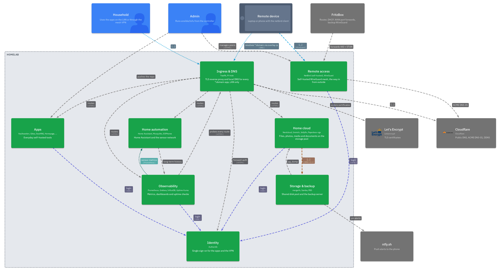

- The diagrams are generated from a LikeC4 model in `architecture/*.c4`, 21 views in total
- `just c4` exports them as PNGs into `docs/img/`
- Views: the landscape above, a deployment view (overview + one per node), one container view per system and 8 flows

## Zones

The network is split into four zones.

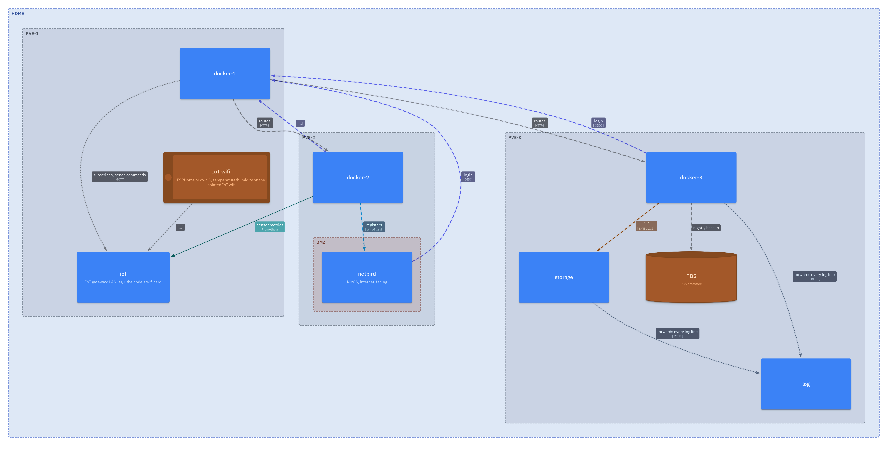

| Zone | Network | What's in it |
|---|---|---|
| LAN | `192.168.178.0/24`, bridge `vmbr0` on every node | All nodes and guests, FRITZ!Box as gateway (`.1`) |
| IoT | `192.168.50.0/24`, bridge `vmbr1` on pve-1 only | ESP32 sensors with static IPs, WiFi from hostapd on pve-1's onboard card |
| DMZ | Inside the LAN, fenced by the PVE firewall | The NetBird VM (`.250`) with its own guest rules |
| WAN | Internet | The FRITZ!Box forwards only to `.250`: 443/tcp, 3478/udp, 49160–49200/udp |

- docker-1 has a second network card in the IoT zone, so the sensors can reach the MQTT broker

## Nodes

Three Proxmox nodes, each with one Docker VM.

**pve-1**: Dell Wyse 5070, 8 GB RAM
- Runs docker-1 and the IoT WiFi (hostapd)

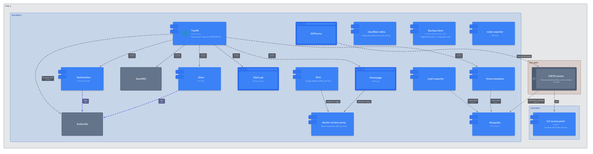

**pve-2**: Dell Wyse 5070, 8 GB RAM
- Runs docker-2 and the NetBird VM
- Hosts the WAN-facing NetBird VM, so it is kept separate from the data services

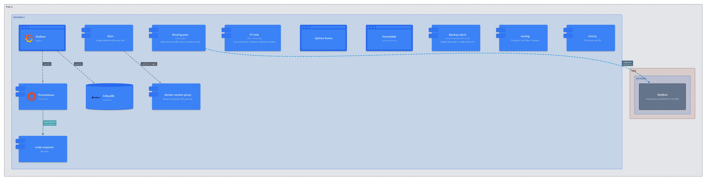

**pve-3**: custom build, 16 GB RAM, 1 SSD + 4 HDDs
- Runs docker-3, the storage LXC and the log LXC
- Has the mergerfs pool
- PBS is installed directly on the host

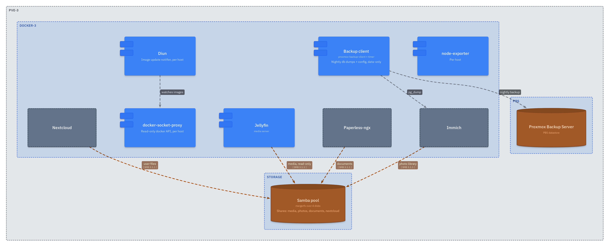

Ansible also sets up a couple of services on the hosts themselves:

| Service | Where |
|---|---|
| login-notify | All nodes |
| pve_firewall | All nodes |
| AIDE | All nodes |
| mergerfs | pve-3 |
| hostapd | pve-1 |

- `update.yml` updates every apt host one at a time (LXCs, VMs, then the nodes), restarts stale services, re-baselines AIDE and reports pending reboots ([0024](adr/0024-ansible-run-os-updates.md))

## Compute

Each node runs one Docker VM, grouped by what the apps need.

| VM | Node | Purpose | Apps |
|---|---|---|---|
| docker-1 (VM 201) | pve-1 | Core | Traefik, Authentik, Vaultwarden, Gitea, Homepage, Home Assistant, MQTT, ESPHome, SearXNG, pdfcraft, DDNS |
| docker-2 (VM 202) | pve-2 | Monitoring and DNS | Pi-hole, Prometheus, Grafana, InfluxDB, Gatus, nginx |
| docker-3 (VM 203) | pve-3 | Private cloud | Nextcloud, Immich, Jellyfin, Paperless |

- All three also run Diun, docker-socket-proxy, the PBS client and AIDE
- docker-3 gets to run the heavy services, because pve-3 has the most RAM
- The full per-node picture is in the deployment views under [Nodes](#nodes)

How a VM is built:
- OpenTofu creates it from the Debian genericcloud image
- cloud-init sets the IP, the admin user and the SSH key
- `vm-preparation.yml` hardens it (`roles/vm_base`) and installs Docker
- Every VM has `prevent_destroy`, because the databases live on the VM disk ([ADR 0005](adr/0005-prevent-destroy-on-stateful-vms.md))

Memory:
- Guests start with their full RAM
- The host can take memory back through ballooning, but never below a floor that covers real usage
- The VMs have no disk swap (the NetBird VM has zram), the LXCs get a small swap

How an app is deployed:
- Each app is a folder `ansible/apps/<name>/` plus a playbook `deploy-<name>.yml`
- All compose apps use the same `docker_app` role ([ADR 0002](adr/0002-generic-docker-app-role.md)), hostapd on pve-1 is plain tasks
- App data lives under `/opt/stacks/<name>` (`apps_root`) on the VM

## Storage

The bulk storage is one big pool on pve-3, shared to the Docker VMs over SMB.

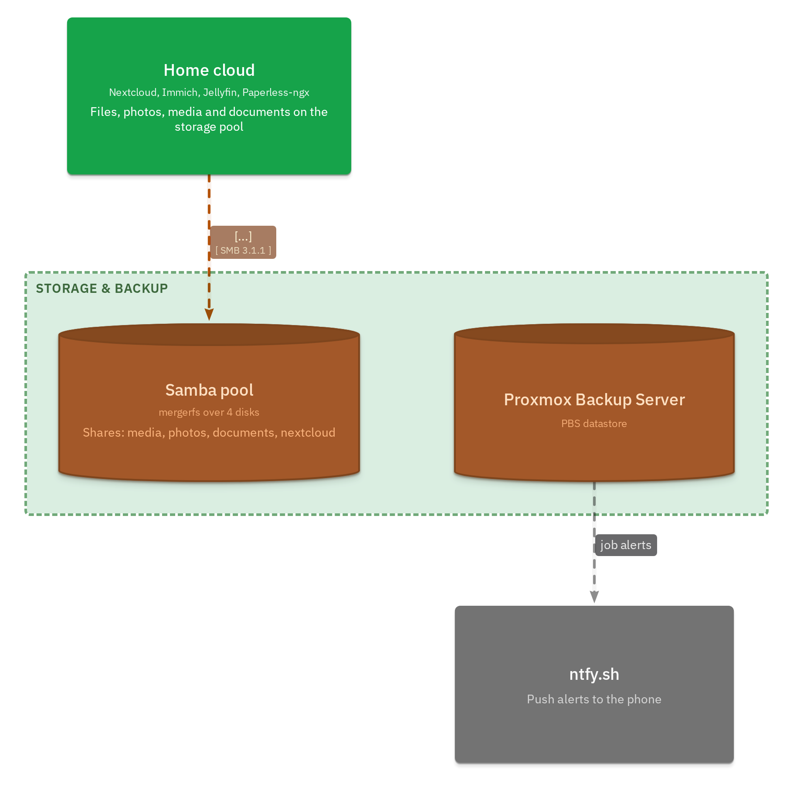

The pool:
- 4 disks in pve-3: 3× 3 TB and 1× 2 TB, about 11 TB together
- Each disk is plain ext4, mounted by UUID
- mergerfs joins them into one folder, `/mnt/storage/pool`
- New files go to the disk with the most free space (`category.create=mfs`)
- A disk with less than 20 GB free gets no new files (`minfreespace=20G`)
- The pool only mounts once all 4 disks are there
- There is no parity: if a disk dies, only the files on that disk are lost ([ADR 0004](adr/0004-mergerfs-instead-of-zfs.md))

The sharing:
- The storage LXC (CT 300, unprivileged) gets the pool as a bind mount at `/srv/storage`
- Samba (SMB3) in the LXC shares it out
- Shares: backups, iso, media, nextcloud, documents, photos, homelab and timemachine (capped at 1 TB)
- Every share except homelab and timemachine (admin only) has its own service user, the group IDs count up from a base number
- docker-3 mounts the shares it needs over CIFS under `/srv/<share>`, with the app's UID/GID
- Databases never go on CIFS, they stay on the VM disk

## DNS

All name resolution goes through Pi-hole on a fixed service IP.

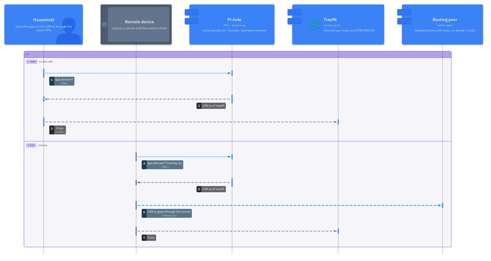

- The FRITZ!Box hands out `.53` as the only IPv4 DNS server
- `.53` is a second IP on docker-2 (`dns-ip.service`), not the VM's own address
- Pi-hole blocks ads and answers the internal names (split horizon)
- One wildcard record points every app name at Traefik (`.201`), so new apps need no DNS record
- The one exception is the NetBird hostname, which points straight at `.250`
- Remote clients get the same answers through NetBird's nameserver group
- If DNS moves to another VM later, only the service IP moves and no client changes ([ADR 0010](adr/0010-pihole-on-a-service-ip.md))

## Request path

How a request from a browser reaches an app.

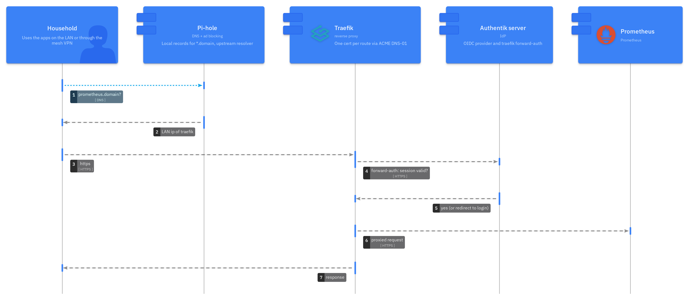
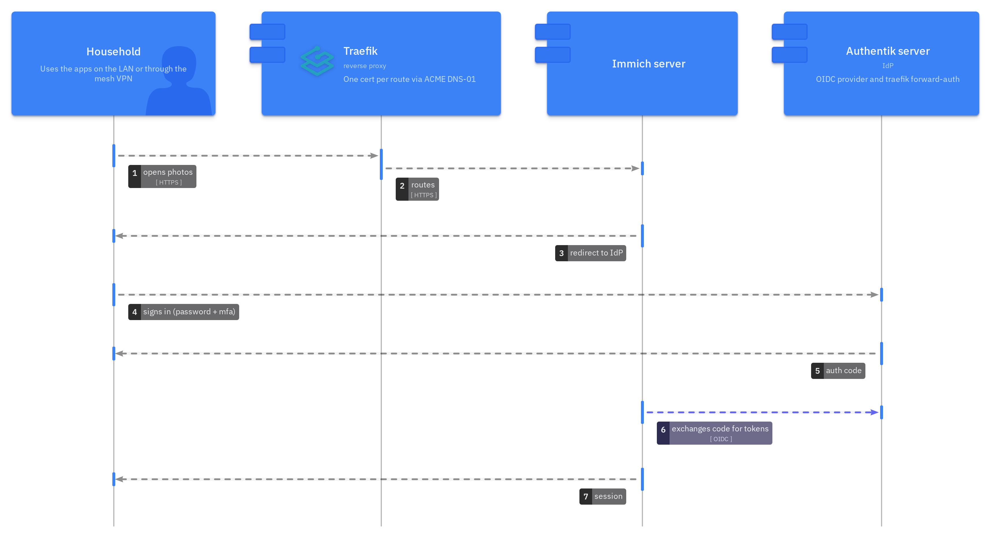

1. The client asks Pi-hole for the app's name and gets Traefik's IP
2. Traefik (on docker-1) picks the app by its hostname (`Host()` rule)
3. If the app needs a login, Authentik checks it first, either through OIDC or forward-auth
4. Traefik passes the request on to the app

- Plain HTTP on port 80 only redirects to HTTPS on 443
- Apps on docker-1 are found through their container labels
- Apps on docker-2/3 and the PVE/PBS web UIs are listed in a file instead (`apps/proxy/traefik/dynamic/remote_services.yml`, 15 routes)
- The apps on docker-2/3 publish their ports, but the `DOCKER-USER` firewall chain only lets a few callers in:
  - Traefik, Homepage and Home Assistant from docker-1
  - Prometheus, Grafana and Gatus from docker-2

## Certificates

All certificates come from Let's Encrypt, proven through DNS instead of an open port.

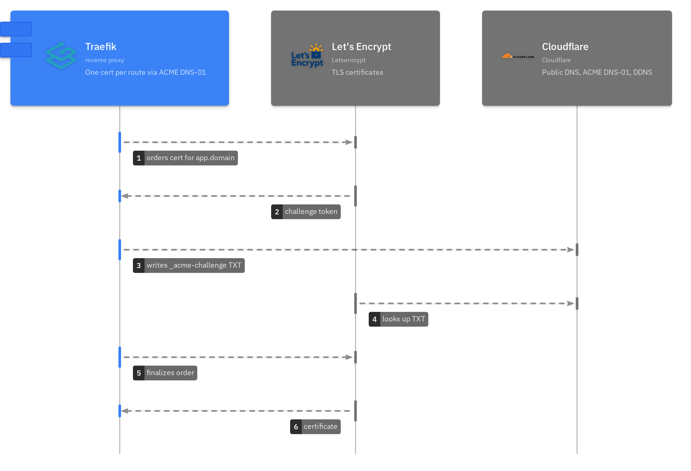

- Let's Encrypt checks a DNS record at Cloudflare (DNS-01), so port 80 doesn't need to be reachable
- Traefik gets one certificate per router for the LAN apps
- The NetBird VM gets its own certificate the same way (nginx + ACME)
- cloudflare-ddns keeps the public DNS record pointed at the current WAN IP

## Identity

Authentik is the single login for the apps.

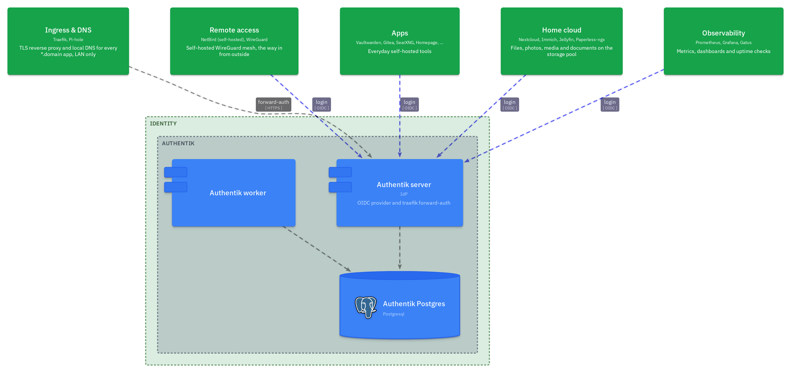

- Authentik runs on docker-1 (server, worker and Postgres)
- Its version is pinned and updated one release at a time (`authentik_tag` / `authentik_series`, checked in `deploy-authentik.yml`)
- Apps that support OIDC log in through Authentik: Gitea, Nextcloud, Immich, Paperless, Vaultwarden, Grafana, Jellyfin, NetBird
- Each of those apps keeps a local admin as a break-glass account, except Vaultwarden (SSO only)
- Apps without their own login sit behind Traefik's forward-auth (`authentik@file`): Traefik dashboard, Prometheus, ESPHome, the Vaultwarden admin page
- Containers can't resolve internal names: apps on docker-1 reach `auth.<domain>` through a network alias on Traefik, apps on docker-2/3 through an `extra_hosts` entry pointing at docker-1

## Remote access

NetBird gives remote access to the LAN without opening any app to the internet.

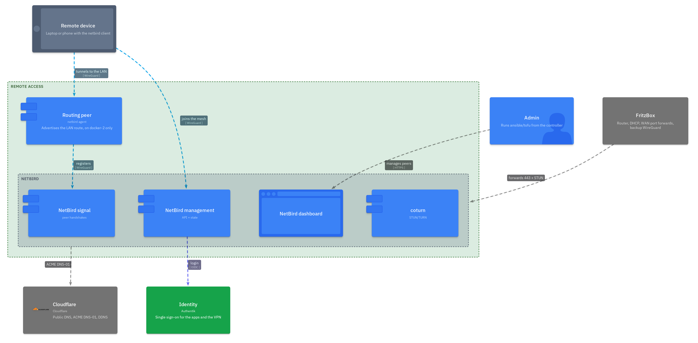
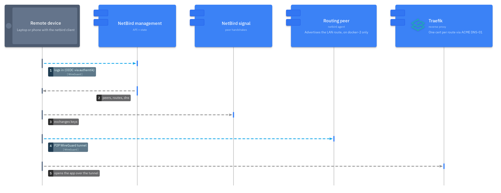

The control plane:
- Runs on its own NixOS VM, no Docker
- Parts: management, signal, dashboard, coturn (STUN/TURN) and nginx in front
- From the WAN, only the gRPC paths the clients need answer
- The dashboard and API only answer from the LAN or VPN
- Requests from outside get the connection closed (444), repeated probes get banned by fail2ban
- Logging in to NetBird goes through Authentik (OIDC)

The routing:
- docker-2 is the routing peer (`netbird_agent` role) and forwards traffic into the LAN
- NetBird's DNS management is off for docker-2's group, so Pi-hole keeps port 53 ([ADR 0003](adr/0003-netbird-instead-of-port-forwards.md), [ADR 0010](adr/0010-pihole-on-a-service-ip.md))
- Peers talk to each other directly over WireGuard, the TURN relay is only a fallback

The fallback:
- The FRITZ!Box has its own WireGuard server, independent of the cluster
- Never use both tunnels at once, both route the LAN and break each other

## Backups

PBS backs up the app data. The VMs themselves are rebuilt from code.

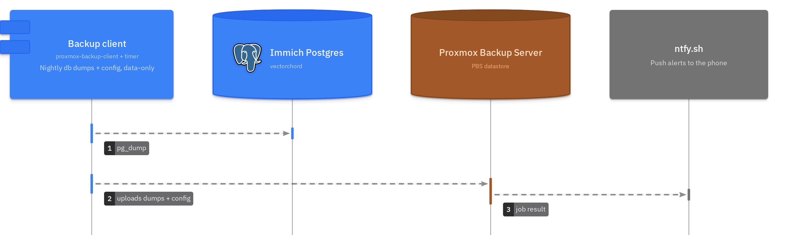
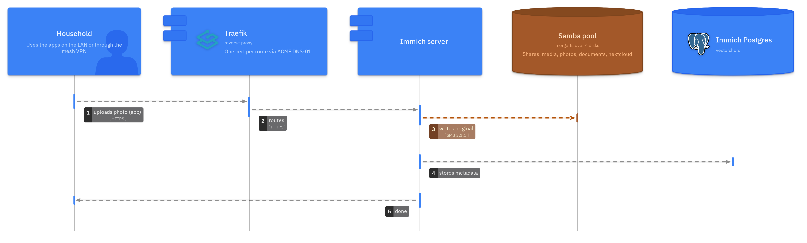

Where backups go:
- PBS runs on the pve-3 host
- Its datastore `homelab` is a 100 GB thin LV on the SSD, separate from the HDD pool

How a backup runs:
- Every Docker VM has the PBS client (`roles/pbs`), started by a timer every evening at 20:00
- A random delay keeps the hosts from starting at the same time
- First the databases are dumped (Postgres, SQLite `.backup`, Influx)
- Then `/opt/stacks` (`apps_root`) goes up as one archive, and `/srv/apps` (`podman_apps_root`) as a second one once the host runs a Podman app
- A failed run is pushed to ntfy
- The client's token can only write backups, not delete them

What's in and out:
- Which databases each host dumps is set in `pbs_jobs` in `host_vars/`
- Left out: caches, query logs, the Prometheus TSDB and the MQTT broker state
- Bulk media on the pool (photos, media, documents) isn't backed up, it can be synced again
- No VM images: a broken VM is rebuilt with OpenTofu + Ansible and the data restored ([ADR 0013](adr/0013-pbs-file-level-backups.md))

## Monitoring

Prometheus for metrics, ntfy for alerts.

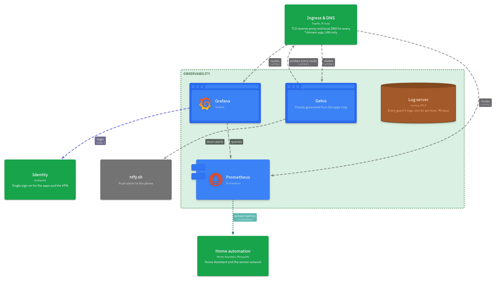

- Prometheus on docker-2 collects metrics from:
  - the PVE hosts
  - node-exporter and the Docker engine on every VM
  - the ESP32 sensors, through mqtt-exporter
- InfluxDB keeps the sensor data long-term
- Grafana shows dashboards on top of both
- Gatus checks every route, host and PVE node and has a status page. Its checks are generated from `apps.yml` and the inventory
- Homepage is the start page, with live tiles from Docker (through the socket proxy) and the Proxmox API

Alerts:
- Diun checks every running image once a day and reports new versions, it never pulls them ([ADR 0006](adr/0006-latest-images-notify-only.md))
- ntfy (an ntfy.sh topic) is the only alert channel ([ADR 0019](adr/0019-ntfy-single-alert-channel.md))
- PBS, AIDE, login-notify and Diun all send there

## Logging and time

Every guest keeps its logs locally and sends them to the log LXC.

- journald keeps the journal in RAM only, rsyslog reads it and writes `/var/log/messages`, `secure`, `cron`, `maillog` and `boot.log` (4 weeks)
- rsyslog forwards everything over RELP to the log LXC (CT 301 on pve-3), which writes `/var/log/remote/<host>/<program>.log` and keeps 90 days
- A disk queue on each guest holds the messages while the log LXC is down
- The log LXC only takes RELP from the known hosts (PVE firewall), the directory name comes from the sender's ip ([ADR 0022](adr/0022-central-logging-relp.md))
- The NetBird VM does the same from `nixos/base/`, but journald pushes to rsyslog over the syslog socket, and there's no `cron` or `maillog`
- The PVE nodes keep their own persistent journal

Time:
- chrony on every VM, only from NTS servers (PTB and Cloudflare), so the time is authenticated ([ADR 0023](adr/0023-chrony-with-nts.md))
- The LXCs use the host's clock

Cron:
- cronie runs the host cron jobs on the Docker VMs and the LXCs

## Home automation

The sensors talk MQTT, their data ends up in Prometheus and InfluxDB.

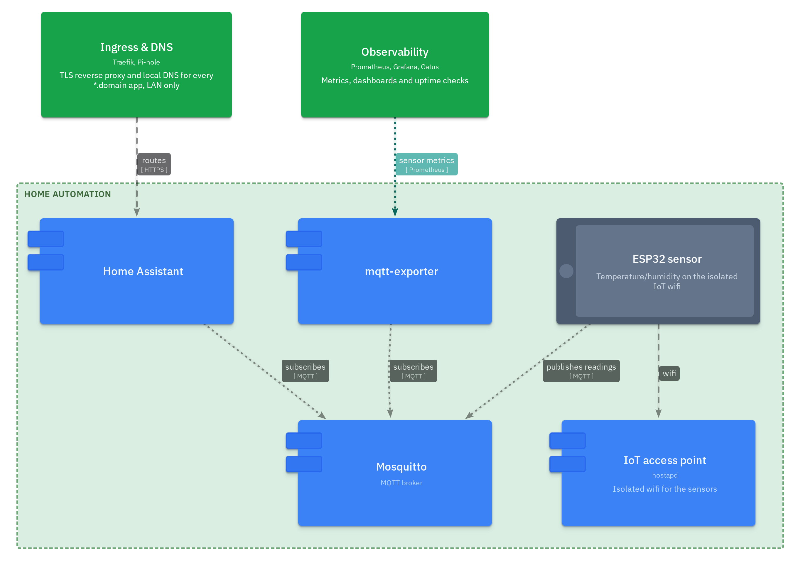

- Data flow: ESP32 → Mosquitto (docker-1) → mqtt-exporter → Prometheus/Grafana + InfluxDB
- Home Assistant and ESPHome also run on docker-1
- The sensors send over MQTT, not over the ESPHome API

## Delivery

How a change gets from git to the machines.

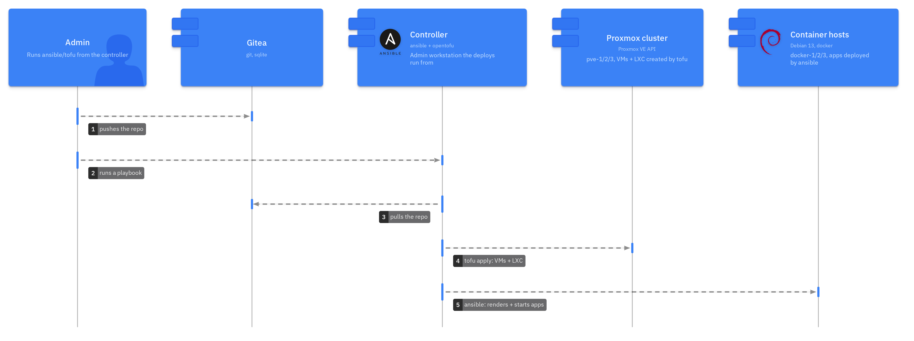

Deploying, from the controller:
- `tofu apply` for the VMs and the LXCs
- `ansible-playbook` for the hosts and the apps
- `nixos/update.sh` for the NetBird VM

Checking:
- `just check` runs the same 18 pre-commit hooks as CI ([ADR 0020](adr/0020-same-checks-locally-and-in-ci.md))
- They cover yamllint, ansible-lint (production profile), shellcheck, tofu fmt/validate, nix flake check, LikeC4 validate and gitleaks
- Plus small checks for whitespace, private keys and file sizes
- CI has two workflows: `ci.yml` runs the checks on pushes to main and testing and on every PR, `pages.yml` publishes the LikeC4 site when `architecture/` changes on main
- All GitHub Actions are pinned to a commit SHA
