# Architecture

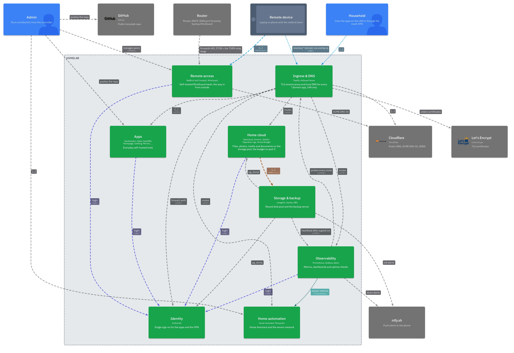

- The diagrams are generated from a LikeC4 model in `architecture/*.c4`, 24 views in total
- `just c4` exports them as PNGs into `docs/img/`
- Views: the landscape above with every edge, a short version of it for the README (`index`), a deployment view (overview + one per node), one container view per system and 10 flows

What runs where:
- Three Proxmox nodes, each with one Debian pod VM that runs its apps as rootless Podman quadlets
- Two NixOS VMs: edge (Traefik + AdGuard Home, routes and DNS names from `apps.yml`) and NetBird, the only box forwarded from the WAN
- LXCs for the storage pool (Samba over mergerfs), the central logs and the IoT gateway, Home Assistant as an appliance VM
- Authentik logs into the apps, PBS backs up the app data, the VMs are rebuilt from code
- Prometheus, Grafana and Gatus watch it, alerts go to ntfy

Sections: [Zones](#zones) · [Nodes](#nodes) · [Compute](#compute) · [Storage](#storage) · [DNS](#dns) · [Request path](#request-path) · [Certificates](#certificates) · [Identity](#identity) · [Remote access](#remote-access) · [Backups](#backups) · [Monitoring](#monitoring) · [Logging and time](#logging-and-time) · [Home automation](#home-automation) · [Delivery](#delivery)

## Zones

The network is split into four zones.

| Zone | Network | What's in it |
|---|---|---|
| LAN | `192.168.178.0/24`, bridge `vmbr0` on every node | All nodes and guests, router as gateway (`.1`) |
| IoT | `192.168.50.0/24`, pve-1's onboard WiFi card, moved into the IoT gateway LXC | ESP32 sensors with static IPs and the gateway (`.10`), which runs the WiFi (hostapd) and DHCP (dnsmasq). Static .2 to .49, DHCP .50 to .200. No Proxmox bridge, no node in the zone |
| DMZ | Inside the LAN, fenced by the PVE firewall | The NetBird VM (`.250`) with its own guest rules |
| WAN | Internet | The router forwards only to `.250`: 443/tcp, 3478/udp, 49160–49200/udp |

- Only the IoT gateway LXC is in the IoT zone, no VM and no node ([ADR 0029](adr/0029-wifi-card-in-the-gateway.md))

## Nodes

Three Proxmox nodes, each with one pod VM.

**pve-1**: small form factor PC, 8 GB RAM
- Runs pod-1, edge and the IoT gateway LXC, which holds pve-1's WiFi card

**pve-2**: small form factor PC, 8 GB RAM
- Runs pod-2 and the NetBird VM
- Hosts the WAN-facing NetBird VM, so it is kept separate from the data services

**pve-3**: desktop PC, 16 GB RAM, 1 SSD + 4 HDDs
- Runs pod-3, the HAOS VM, the storage LXC and the log LXC
- Gets turned off now and then, so only what may be down runs here
- Has the mergerfs pool
- PBS is installed directly on the host

Ansible also sets up a couple of services on the hosts themselves:

| Service | Where |
|---|---|
| login-notify | All nodes |
| pve_firewall | All nodes |
| AIDE | All nodes |
| pve_thinpool | All nodes |
| mergerfs | pve-3 |

- `update.yml` updates every apt host one at a time (LXCs, VMs, then the nodes), restarts stale services, re-baselines AIDE and reports pending reboots ([0024](adr/0024-ansible-run-os-updates.md))

## Compute

Each node runs one pod VM, grouped by what the apps need. Ingress and LAN DNS run on their own NixOS VM, edge.

- pod-1 (VM 201, pve-1): core, Authentik, Vaultwarden and the small everyday apps
- pod-2 (VM 202, pve-2): monitoring, the VPN's dns-relay and routing peer, Actual Budget, the website
- pod-3 (VM 203, pve-3): the home cloud (Nextcloud, Immich, Jellyfin, Paperless) on the storage pool, plus linkding, Memos, Excalidraw
- edge (VM 200, pve-1): ingress and DNS on NixOS, Traefik and AdGuard Home
- Full app list: [README](../README.md#what-runs)

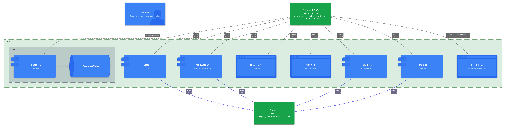

- Every app runs as a rootless Podman quadlet, no Docker. All three run the PBS client and AIDE
- Home Assistant runs as HAOS, an appliance VM on pve-3 (VM 210, `haos_ip`): it updates and configures itself inside, Ansible never logs in. It's off whenever pve-3 is
- pod-3 runs the heavy services, pve-3 has the most RAM
- The full per-node picture is in the deployment views under [Nodes](#nodes)

How a VM is built:
- OpenTofu creates it from the Debian genericcloud image
- cloud-init sets the IP, the admin user and the SSH key
- `vm-preparation.yml` hardens it (`roles/vm_base`) and installs Podman
- Every VM has `prevent_destroy`, because the databases live on the VM disk ([ADR 0005](adr/0005-prevent-destroy-on-stateful-vms.md))

Memory:
- Guests start with their full RAM
- The host can take memory back through ballooning, but never below a floor that covers real usage
- The VMs have no disk swap (the NixOS VMs have zram), the LXCs get a small swap

How an LXC is built:
- OpenTofu creates it unprivileged from the Debian 13 template, Proxmox writes the IP, root's SSH key and the hostname (no cloud-init)
- `base.yml` adds `roles/lxc_base`: SSH key-only, fail2ban, unattended security updates, node_exporter
- The firewall depends on the LXC: ufw in storage, the PVE firewall in front of log, both in front of iot's LAN leg, ufw alone on its WiFi

How an app is deployed:
- Each app is an entry in `apps.yml` plus a folder `ansible/apps/<name>/` with its quadlet units
- `deploy-app.yml -e app=<name>` runs the `podman_app` role: svc user, secrets, units, firewall ([ADR 0021](adr/0021-podman-quadlets.md), [podman-layout](podman-layout.md))
- App data lives under `/srv/apps/<name>` (`podman_apps_root`)

## Storage

The bulk storage is one big pool on pve-3, shared to the pod VMs over SMB.

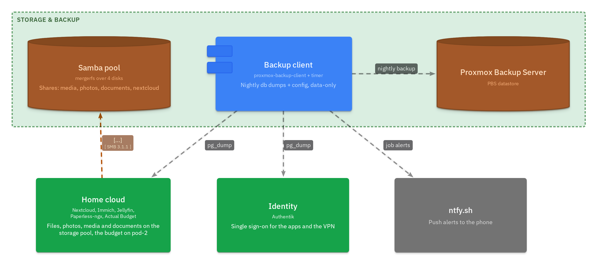

The pool:
- 4 disks in pve-3: 3× 3 TB and 1× 2 TB, about 11 TB together
- Each disk is plain ext4, mounted by UUID
- mergerfs joins them into one folder, `/mnt/storage/pool`
- New files go to the disk with the most free space (`category.create=mfs`)
- A disk with less than 20 GB free gets no new files (`minfreespace=20G`)
- The pool only mounts once all 4 disks are there
- There is no parity: if a disk dies, only the files on that disk are lost ([ADR 0004](adr/0004-mergerfs-instead-of-zfs.md))

The sharing:
- The storage LXC (CT 300, unprivileged) gets the pool as a bind mount at `/srv/storage`
- Samba (SMB3) in the LXC shares it out
- Shares: backups, iso, media, nextcloud, documents, photos, homelab and timemachine (capped at 1 TB)
- Every share except homelab and timemachine (admin only) has its own service user, the group IDs count up from a base number
- pod-3 mounts the shares its apps need over CIFS under `/srv/<path>` (`cifs_mount_root`, `path` from `apps.yml`), with the app's UID/GID
- Databases never go on CIFS, they stay on the VM disk

## DNS

The LAN DNS is AdGuard Home on edge, on a fixed service IP.

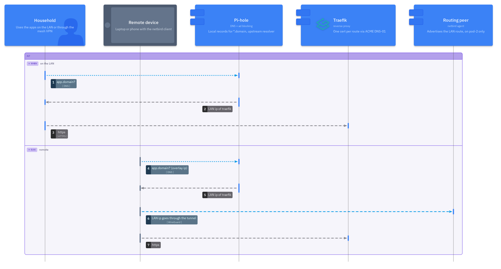

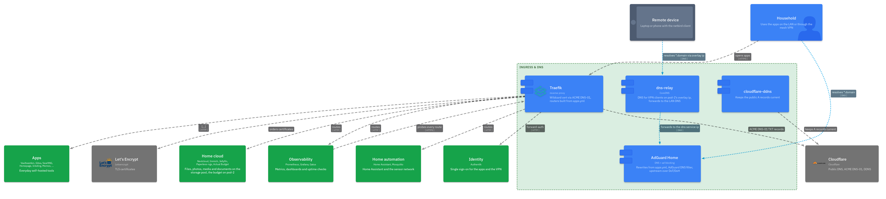

- The router hands out `.53` as the only IPv4 DNS server to DHCP clients
- The two NixOS VMs ask `.53` first, the router is their fallback
- The Debian guests (pod VMs, LXCs) ask the router (`dns` in `tofu/vms.tf`, `tofu/lxc.tf`), which doesn't know the LAN names. Containers that need one pin it with `AddHost=` ([Identity](#identity))
- `.53` is a second IP on edge (`dns_ip_host: edge`, set by networkd), not the VM's own address
- AdGuard Home blocks ads (AdGuard DNS filter) and answers the internal names (split horizon), upstream over DoT/DoH
- Every routed name gets a rewrite to Traefik on edge (`.200`), generated from `apps.yml`, so a new app needs no DNS record of its own. Names that aren't routed go to public DNS
- The one exception is the NetBird hostname, which points straight at `.250`
- Remote clients get the same answers through NetBird's nameserver group: it points at `dns-relay` on pod-2's overlay IP (port 1053), CoreDNS that forwards to the service IP
- When DNS moves to another VM, only the service IP moves and no client changes ([ADR 0010](adr/0010-lan-dns-on-a-service-ip.md), [ADR 0032](adr/0032-edge-vm-traefik-adguard-on-nixos.md))

## Request path

How a request from a browser reaches an app.

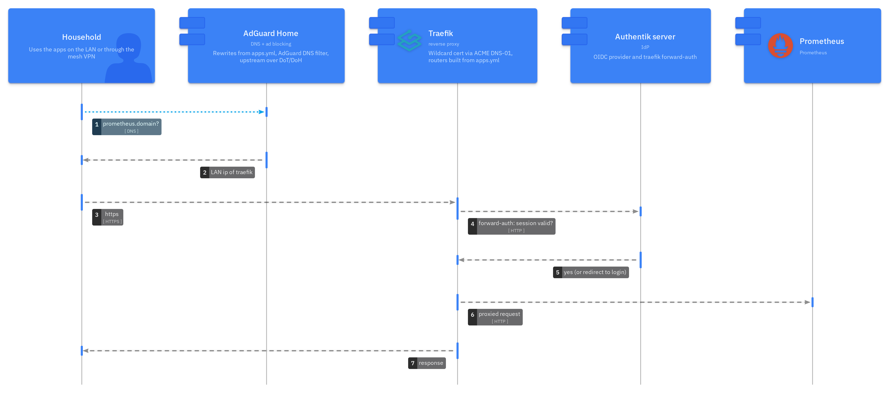
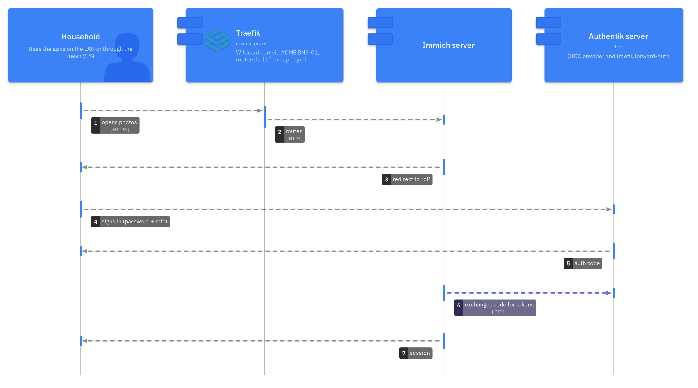

1. The client asks AdGuard Home for the app's name and gets Traefik's IP
2. Traefik (on edge) picks the app by its hostname (`Host()` rule)
3. If the app needs a login, Authentik checks it first, either through OIDC or forward-auth
4. Traefik passes the request on to the app

- Plain HTTP on port 80 only redirects to HTTPS on 443
- Every router comes from `apps.yml` (`routes` of each app plus `infra_routes`), built into Traefik's dynamic config on edge (`nixos/edge/traefik.nix`). There is no hand-written router file
- Cockpit on each pod VM is served as `pod-N.<domain>` through Traefik behind Authentik (`infra_routes`, backend HTTPS with `insecure_tls`). ufw allows its port from `cockpit_allow_from` (edge) only, `roles/vm_base` sets the origin and the proxy header in `cockpit.conf`
- Every app port gets one ufw rule per source, from `allow_from` in `apps.yml`: edge, pod-2 (Prometheus, Gatus), Homepage and, for Gatus' heartbeats, pod-1 and pod-3; Gitea's ssh port: LAN and VPN

## Certificates

All certificates come from Let's Encrypt, proven through DNS instead of an open port.

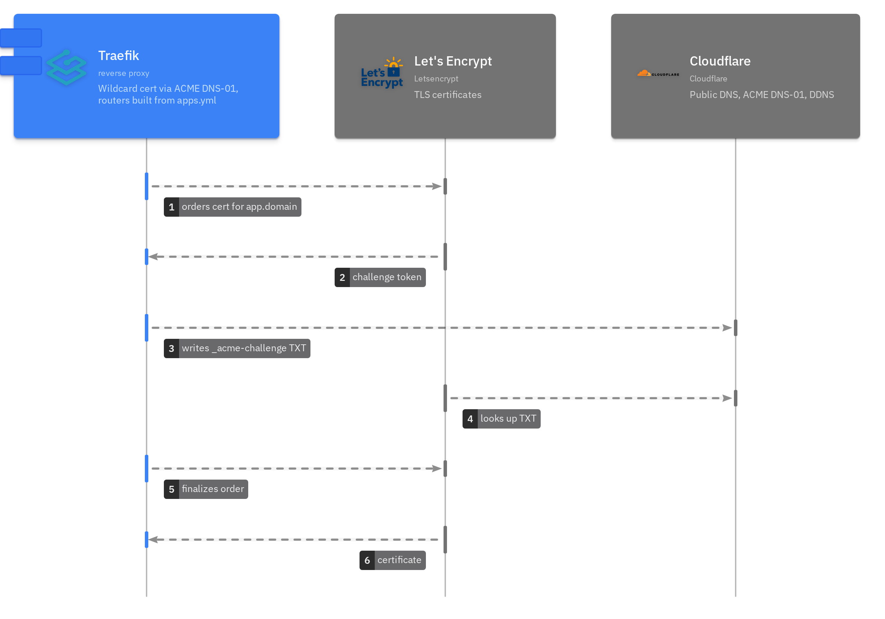

- Let's Encrypt checks a DNS record at Cloudflare (DNS-01), so port 80 doesn't need to be reachable
- Traefik on edge holds one wildcard certificate (`*.<domain>`) for every LAN app
- The NetBird VM gets its own certificate the same way (nginx + ACME)
- cloudflare-ddns keeps the public DNS record pointed at the current WAN IP

## Identity

Authentik is the single login for the apps.

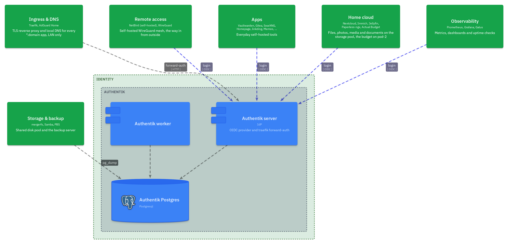

- Authentik runs on pod-1 as one pod (server, worker and Postgres)
- Its version is pinned and updated one release at a time (the tag in `apps.yml`, `authentik_series` in `app_settings.yml`, checked in `deploy-authentik.yml`)
- Apps that support OIDC log in through Authentik: Gitea, Nextcloud, Immich, Paperless, Vaultwarden, Grafana, Jellyfin, Actual Budget, linkding, Memos, NetBird, Semaphore
- Each of those apps keeps a local admin as a break-glass account, except Vaultwarden, Actual Budget and linkding (SSO only)
- UIs without their own login sit behind Traefik's forward-auth (`authentik@file`): Traefik dashboard, AdGuard Home, Prometheus, the Gatus status page, the Vaultwarden admin page, Excalidraw and Cockpit. Which route gets it is `middlewares:` in `apps.yml`
- Containers can't resolve internal names, so each app that logs in through Authentik pins `auth.<domain>` to edge with `AddHost=` (`app_sources.edge`)

## Remote access

NetBird gives remote access to the LAN without opening any app to the internet.

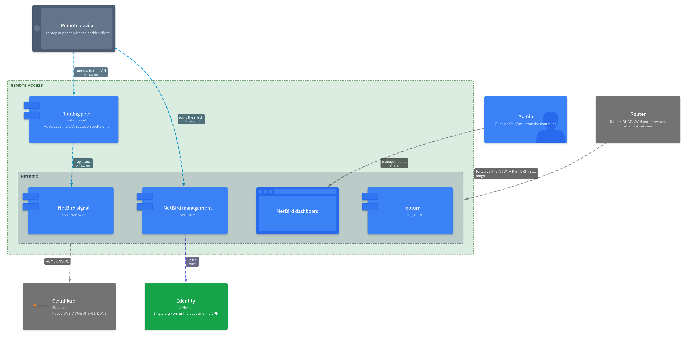
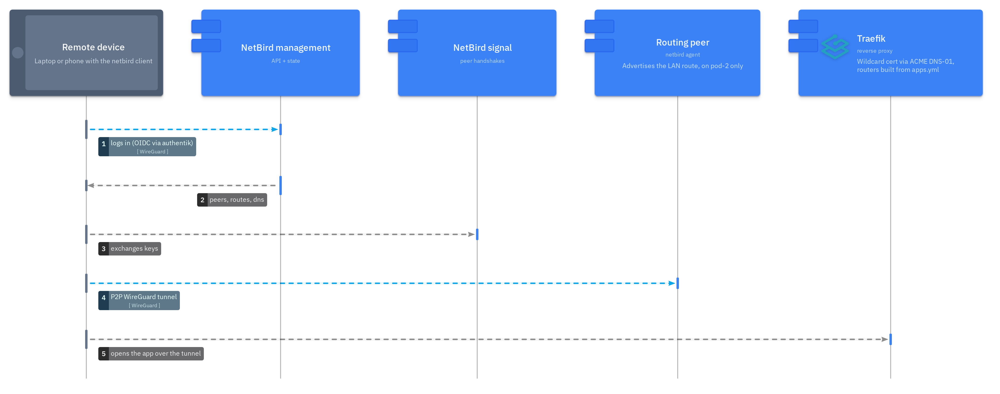

The control plane:
- Runs on its own NixOS VM, no Docker
- Parts: management, signal, dashboard, coturn (STUN/TURN) and nginx in front
- From the WAN, only the gRPC paths the clients need answer
- The dashboard and API only answer from the LAN or VPN
- Requests from outside get the connection closed (444), repeated probes get banned by fail2ban
- Logging in to NetBird goes through Authentik (OIDC)

The routing:
- pod-2 is the routing peer (`netbird_agent` role) and forwards traffic into the LAN
- NetBird's DNS management is off for pod-2's group, so NetBird never takes port 53 on its routing peer ([ADR 0003](adr/0003-netbird-instead-of-port-forwards.md), [ADR 0010](adr/0010-lan-dns-on-a-service-ip.md))
- Policy groups: `admin` reaches the whole LAN, `household` only edge 443 and DNS ([ADR 0040](adr/0040-netbird-policy-as-code.md))
- Peers talk to each other directly over WireGuard, the TURN relay is only a fallback

The fallback:
- The router has its own WireGuard server, independent of the cluster
- Never use both tunnels at once, both route the LAN and break each other

## Backups

PBS backs up the app data. The VMs themselves are rebuilt from code.

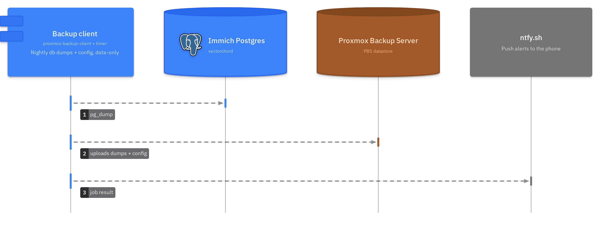
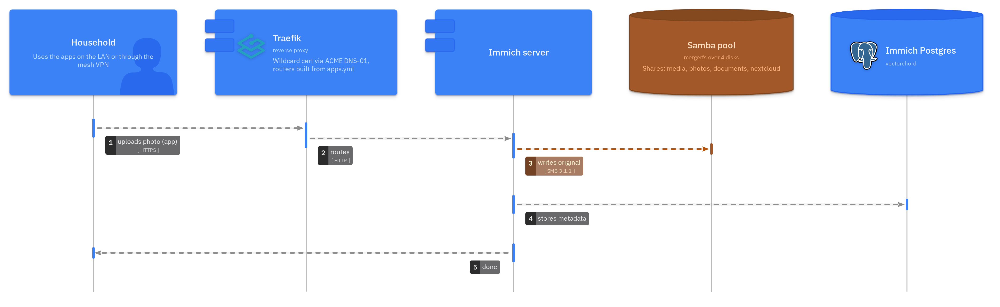

Where backups go:
- PBS runs on the pve-3 host
- Its datastore `homelab` is a 100 GB thin LV on the SSD, separate from the HDD pool

How a backup runs:
- Every pod VM has the PBS client (`roles/pbs`), started by a timer every evening at 20:00
- A random delay keeps the hosts from starting at the same time
- First the databases are dumped (Postgres, SQLite `.backup`)
- Then `/srv/apps` (`podman_apps_root`) goes up as one archive
- A failed run is pushed to ntfy, a good one sends a heartbeat to Gatus, which alerts when it stays away
- What the client's token may do: [roles/pbs](../ansible/roles/pbs/README.md#safety)

What's in and out:
- Which databases each host dumps is set in `pbs_jobs` in `host_vars/`
- Left out: Jellyfin's cache and transcodes, the Prometheus TSDB (`pbs_exclude`). edge, the LXCs and ctl-1 run no PBS client
- Bulk media on the pool (photos, media, documents) isn't backed up; irreplaceable files are kept outside the lab
- No VM images: a broken VM is rebuilt with OpenTofu + Ansible and the data restored ([ADR 0013](adr/0013-pbs-file-level-backups.md))

## Monitoring

Prometheus for metrics, ntfy for alerts.

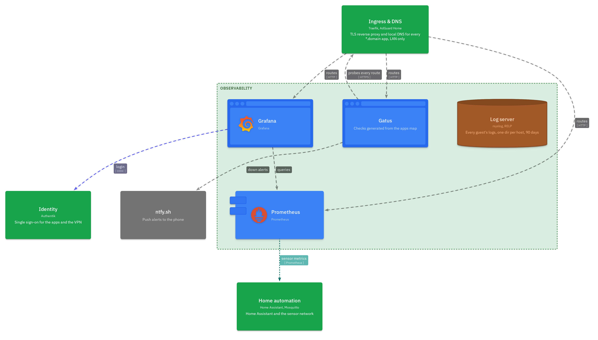

- Prometheus on pod-2 collects metrics from:
  - the PVE hosts, including the thin pools' fill (`roles/pve_thinpool`, node-exporter's textfile collector)
  - node-exporter on every VM and LXC but HAOS (its disk and uptime come from HA's System Monitor)
  - the ESP32 sensors, through mqtt-exporter
  - Gatus (`/metrics`, the check results)
- Grafana shows dashboards on top of it: hosts, PVE and thin pools, sensors and lab health, as JSON in `apps/grafana/config/provisioning/dashboards/` ([ADR 0041](adr/0041-grafana-dashboards-as-code.md)). UI edits to them are reset by the next deploy
- Gatus checks every route, host and PVE node and has a status page. Its checks are generated from `apps.yml` and the inventory
- Gatus also takes pushed heartbeats: each backup host and the Semaphore runs of repo-pull, aide and update report in after a good run, and a missing one alerts. It queries Prometheus per PVE node for the thin pool fill and for the freshness of that data
- Homepage is the start page: Gatus' summary on top, Proxmox stats for nodes, VMs and LXCs, and a tile per app generated from the apps map (`homepage:` block), with an up badge where the map has the app's port

Alerts:
- Podman apps: `podman auto-update` pulls and rolls back on a failed health check, a newer-tag check reports pinned images ([ADR 0021](adr/0021-podman-quadlets.md))
- ntfy (an ntfy.sh topic) is the only alert channel ([ADR 0019](adr/0019-ntfy-single-alert-channel.md))
- PBS, AIDE, login-notify, the image updates and Gatus all send there

## Logging and time

Every guest keeps its logs locally and sends them to the log LXC.

- journald keeps the journal in RAM only, rsyslog reads it and writes `/var/log/messages`, `secure`, `cron`, `maillog` and `boot.log` (4 weeks)
- rsyslog forwards everything over RELP to the log LXC (CT 301 on pve-3), which writes `/var/log/remote/<host>/<program>.log` and keeps 90 days
- A disk queue on each guest holds the messages while the log LXC is down
- The log LXC only takes RELP from the known hosts (PVE firewall), the directory name comes from the sender's ip ([ADR 0022](adr/0022-central-logging-relp.md))
- The NixOS VMs (NetBird, edge) do the same from `nixos/base/logging.nix`, but journald pushes to rsyslog over the syslog socket, and there's no `cron` or `maillog`
- The PVE nodes keep their own persistent journal

Time:
- chrony on every VM, only from NTS servers (PTB and Cloudflare), so the time is authenticated ([ADR 0023](adr/0023-chrony-with-nts.md))
- The LXCs use the host's clock

Cron:
- cronie runs the host cron jobs on the pod VMs and the LXCs

## Home automation

The sensors talk MQTT, their readings end up in Home Assistant and Prometheus. How to add a sensor or rebuild the gateway: [iot.md](iot.md).

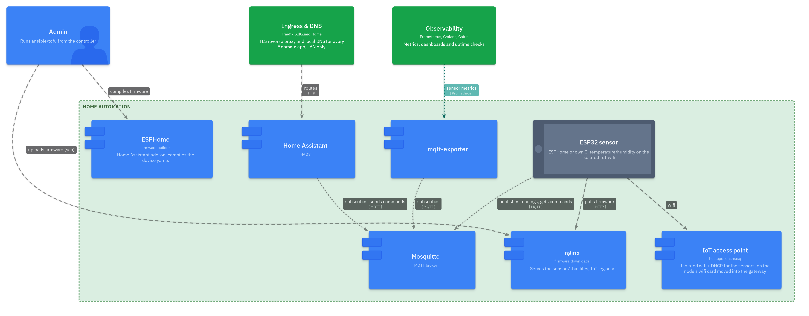

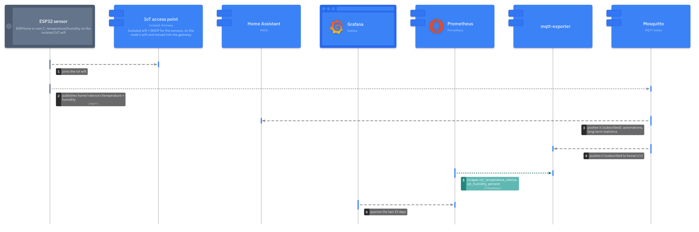

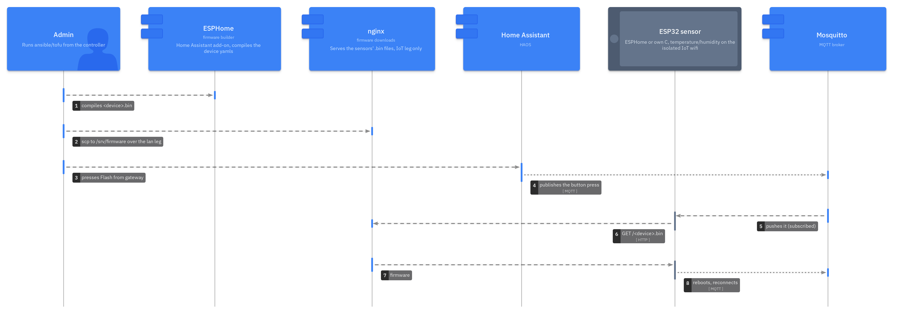

- Data flow: ESP32 → Mosquitto → mqtt-exporter → Prometheus/Grafana, Home Assistant (the HAOS VM on pve-3) subscribes too
- Mosquitto, mqtt-exporter, the OTA server (nginx) and the IoT WiFi (pve-1's card, hostapd + dnsmasq) run in the IoT gateway LXC (`iot`, CT 302), with a second leg on the LAN for the consumers ([ADR 0028](adr/0028-iot-gateway-lxc.md), [ADR 0029](adr/0029-wifi-card-in-the-gateway.md))
- One shared MQTT user, no TLS, plain 1883. Accepted risk: anyone on the IoT WiFi with the password can read and fake every sensor
- Two firewall layers on the LAN leg, ufw alone on the WiFi, nothing routes through the gateway ([iot.md](iot.md#firewall))
- Firmware is pulled from the gateway, nothing connects into the IoT net. Prometheus keeps 15 days, the long-term history is Home Assistant's

## Delivery

How a change gets from git to the machines.

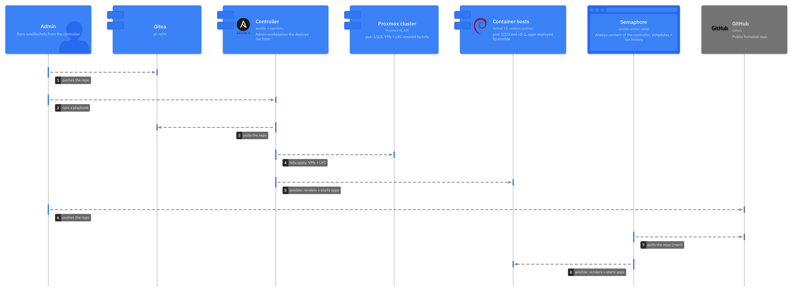

Deploying, from the controller:
- `tofu apply` for the VMs and the LXCs
- `ansible-playbook` for the hosts and the apps
- `nixos/update.sh <netbird|edge>` for the NixOS VMs
- Semaphore on ctl-1 (a single-board computer outside the cluster) runs scheduled playbooks from a git clone of `main`, kept current by `repo-pull.yml`. Only `vault.yml` and `private.yml` are copied from the controller

Checking:
- `just check` runs the same pre-commit hooks as CI ([ADR 0020](adr/0020-same-checks-locally-and-in-ci.md))
- They cover yamllint, ansible-lint (production profile), shellcheck, actionlint, zizmor, tofu fmt/validate, nix flake check, LikeC4 validate and gitleaks
- Plus small checks for whitespace, private keys and file sizes, and the repo's own: `apps.yml` schema, wiring, rendered units, ADR and C4 checks
- CI has three workflows: `ci.yml` runs the checks on pushes to main and testing and on every PR, `podman.yml` runs every unit through `quadlet -dryrun` on the same triggers, `pages.yml` publishes the LikeC4 site when `architecture/` changes on main
- All GitHub Actions are pinned to a commit SHA
