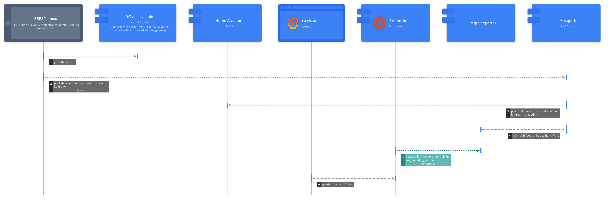
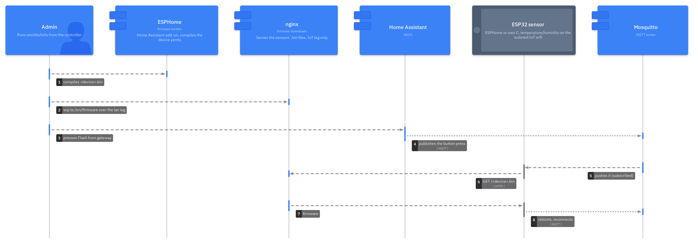

# IoT

How the sensor network is used and run. The why is in [ADR 0028](adr/0028-iot-gateway-lxc.md), the big picture in [architecture.md](architecture.md#home-automation).



## What a device has to do

Every device runs ESPHome (YAML) or my own C code. Either way it only ever opens connections, and only to the gateway: MQTT for readings and commands, HTTP for its firmware. Nothing connects into the IoT net.

| | |
|---|---|
| WiFi | the IoT WiFi from hostapd on the gateway (pve-1's card, moved into CT 302), `192.168.50.0/24` |
| Address | static from `.2`-`.49`; `.50`-`.200` is DHCP (dnsmasq on the gateway, `iot_dhcp_range`) |
| Broker | `192.168.50.10:1883` (`iot_ip`), plain MQTT, no TLS |
| Login | user `iot` (`mqtt_user`), password `mqtt_password` from the vault |
| Topic | `home/<device>/<measurement>`, e.g. `home/livingroom/temperature` |
| Payload | one plain number per topic, no JSON, no unit |
| Home Assistant | MQTT discovery (prefix `homeassistant`), commands come in over MQTT |
| Firmware | pulled from `http://192.168.50.10/<device>.bin`, only when told to |

- `<device>` becomes the `sensor` label in Prometheus, so it has to be unique and stay the same
- ESPHome devices have no `api:` and no push OTA, nothing on them listens
- From the IoT net the gateway answers on 1883, 80 and DHCP only (ufw on `wlan0`), and nothing routes on to the LAN or the internet. The gateway is the only other address in the IoT net, no node is in it
- The password is the same on every device, so changing it means reflashing all of them
- The first flash is by USB, every later one is pulled from the gateway

## ESPHome

Device YAMLs live in the private repo next to the C firmware, `secrets.yaml` comes from the vault and is never in git. They're compiled in the ESPHome add-on on Home Assistant.

Every device includes one shared package. It keeps the contract above in one place:

```yaml
# common/iot.yaml: wifi, broker, topics, firmware pull. needs substitutions device + ip
esphome:
  name: ${device}

logger:

wifi:
  ssid: !secret iot_wifi_ssid
  password: !secret iot_wifi_password
  manual_ip:
    static_ip: ${ip}
    gateway: 192.168.50.10    # esphome wants one, the gateway doesn't route
    subnet: 255.255.255.0

mqtt:
  broker: 192.168.50.10
  port: 1883
  username: iot
  password: !secret mqtt_password
  topic_prefix: home/${device}
  discovery: true             # ha builds the entities from this
  log_topic: null             # keep logs off the broker

http_request:

ota:
  - platform: http_request

button:
  - platform: template
    name: Flash from gateway
    entity_category: config
    on_press:
      - ota.http_request.flash:
          url: http://192.168.50.10/${device}.bin
          md5_url: http://192.168.50.10/${device}.md5
```

A device then only adds its board and sensors, each with a `state_topic` in the contract's form:

```yaml
substitutions:
  device: livingroom
  ip: 192.168.50.20

packages:
  iot: !include common/iot.yaml

esp32:
  board: esp32dev

sensor:
  - platform: dht
    pin: GPIO4
    model: DHT22
    update_interval: 60s
    temperature:
      name: Temperature
      state_topic: home/${device}/temperature
    humidity:
      name: Humidity
      state_topic: home/${device}/humidity
```

- Without `state_topic` ESPHome publishes to `home/<device>/sensor/<name>/state`, which the exporter doesn't read
- `topic_prefix` also puts ESPHome's own status (`home/<device>/status`) and the button's command topic under the device; the exporter ignores what isn't in `mqtt_exporter_metrics`

## Add a sensor

1. Pick a free static address from `.2`-`.49` and a device name
2. ESPHome: a device YAML with the shared package, the address and the name. C: broker address, user, password and device name in the firmware's `secrets.h` (private repo)
3. Flash it by USB
4. Check the readings arrive on the gateway:
   ```
   ssh iot
   mosquitto_sub -h localhost -u iot -P '<password>' -t 'home/#' -v
   ```
5. Check Prometheus: `iot_temperature_celsius{sensor="<device>"}`
6. In Home Assistant the device shows up through MQTT discovery, with its sensors and the "Flash from gateway" button

A new kind of measurement (not temperature or humidity) also needs a line in `mqtt_exporter_metrics` (`roles/mqtt_exporter/defaults/main.yml`) and `ansible-playbook playbooks/deploy-iot.yml`. Without it the broker carries the topic, but Prometheus doesn't see it.

## Update the firmware



Devices pull their firmware from the gateway (`roles/ota_server`: nginx on `iot_ip:80`, `/srv/firmware`, read-only, no listing). Nothing checks for or installs updates on its own.

1. ESPHome add-on: Install → Manual download → OTA format, save it as `<device>.bin`
2. The checksum next to it: `md5sum <device>.bin | cut -d' ' -f1 > <device>.md5`
3. Copy both to the gateway over the LAN leg:
   ```
   scp <device>.bin <device>.md5 root@192.168.178.152:/srv/firmware/
   ```
4. Home Assistant: the device → "Flash from gateway"
5. The device downloads the file, checks the md5, writes it and reboots. `journalctl -u nginx` on the gateway shows the GET
6. AIDE watches `/srv/firmware`, accept the new files: `ansible-playbook playbooks/aide-accept.yml -l iot`

C devices follow the same contract: a command over MQTT starts a download of `http://192.168.50.10/<device>.bin`.

## Home Assistant

The broker is set in the UI, not in the repo:

- Settings → Devices & services → Add integration → MQTT
- Broker `192.168.178.152` (`iot_lan_ip`, the gateway's LAN leg), port `1883`, user `iot`, the vault password
- Discovery on, prefix `homeassistant` (the defaults)

HA keeps the long-term history of every sensor (long-term statistics, hourly). Prometheus keeps 15 days.

## Build the gateway

From scratch, e.g. after losing the LXC. Nothing on it needs a backup: config is in git, the broker keeps no state worth keeping, the firmware files are rebuilt in the ESPHome add-on.

1. `macs.iot` in `private.yml`, `mqtt_password`, `wifi_ssid` and `wifi_pass` in the vault
2. The LXC template on `iot_node`: `pveam download local debian-13-standard_13.6-1_amd64.tar.zst`
3. `ansible-playbook playbooks/deploy-pve-firewall.yml`, so CT 302 never runs without its rules
4. `tofu apply -target=proxmox_virtual_environment_container.iot`
5. `ansible-playbook playbooks/base.yml -l iot` and `playbooks/login-banner.yml -l iot`
6. `ansible-playbook playbooks/deploy-iot.yml`: first the WiFi card into the CT (raw `lxc.net` lines on `iot_node`, restarts the CT), then WiFi + DHCP, broker, exporter, OTA server, ufw. A rebuilt CT loses the raw lines, this puts them back
7. Copy the current `.bin` and `.md5` files back to `/srv/firmware`
8. `ansible-playbook playbooks/aide.yml -l iot`, last, so the baseline is the finished box
9. `ansible-playbook playbooks/deploy-app.yml -e app=prometheus` and `-e app=gatus` if the address changed

## Check it

```
ansible iot -m shell -a "systemctl is-active hostapd dnsmasq mosquitto prometheus-mqtt-exporter prometheus-node-exporter nginx; iw dev; ip -br addr show wlan0; ufw status"
```

- WiFi: `iw dev` shows `wlan0` as `type AP` with the SSID, `wlan0` has `192.168.50.10`. On pve-1 `iw dev` is empty, the card is in the CT
- Prometheus targets: `iot_sensors` and `node-exporter` on `192.168.178.152` are up
- Exporter: `curl -s 192.168.178.152:9641/metrics | grep iot_` from docker-2
- OTA server, on the gateway: `curl -sI http://192.168.50.10/<device>.bin` is a 200, `curl -sI http://192.168.50.10/` a 404, and nothing answers on `192.168.178.152:80`
- Logs: `journalctl -u hostapd -u dnsmasq -u mosquitto -u prometheus-mqtt-exporter -u nginx` on the gateway (associations, leases), or `/var/log/remote/iot/` on the log LXC

## Move to pve-2

pve-2 has the same WiFi card. A move touches:

- `iot_node` in `network.yml`, and `iot_wifi_nic` if the card has another name there (`iw dev` on pve-2)
- the LXC template on pve-2; tofu rebuilds the LXC, `deploy-iot.yml` moves the card in
- nothing else on the node: no bridge, no DHCP, only the regulatory domain (`deploy-iot.yml` sets it)
- pve-2 also runs the NetBird DMZ VM, so IoT and DMZ share a node
